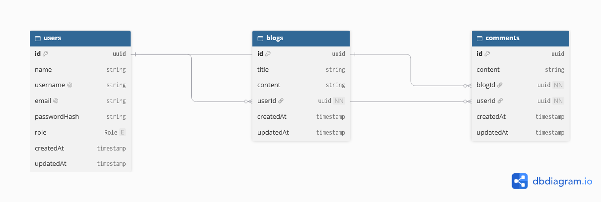

# Blogly

A RESTful blog API built with NestJS, TypeScript, Prisma and PostgreSQL. It includes JWT authentication, role-based access control and automated tests.

## Features

- JWT authentication: users register, log in and receive an access token
- Role-based access control: user and admin roles with different permissions
- 15 REST endpoints across 3 database tables
- Request validation with DTOs
- Database schema managed with Prisma migrations

## Tech stack

| Area               | Technology                  |
| ------------------ | --------------------------- |
| Framework          | NestJS                      |
| Language           | TypeScript                  |
| Database           | PostgreSQL (hosted on Neon) |
| ORM and migrations | Prisma                      |
| Authentication     | JWT                         |
| Code quality       | Oxlint, Prettier            |

## Entity-relationship diagram



A user can write many blogs, and a blog can have many comments. A user can leave a comment
on any blog.

## Getting started

### Prerequisites

- Node.js version ^24
- A PostgreSQL database (a free [Neon](https://neon.tech) database works)

### Setup

```bash
git clone https://github.com/mosesamiedor/blogly.git
cd blogly
npm install
```

Create your environment file:

```bash
cp .env.example .env
```

Then fill in the values in `.env`.

Apply the database migrations and start the server:

```bash
npx prisma migrate dev
npm run start:dev
```

The API runs at `http://localhost:3000`.

### Environment variables

| Variable       | Description                  |
| -------------- | ---------------------------- |
| `DATABASE_URL` | PostgreSQL connection string |
| `JWT_SECRET`   | Secret used to sign tokens   |

## Database and migrations

The schema lives in `prisma/`. Migrations are applied with Prisma Migrate:

```bash
npx prisma migrate dev
npx prisma migrate deploy
```

## API endpoints

| Method | Path              | Access                     | Description                  |
| ------ | ----------------- | -------------------------- | ---------------------------- |
| POST   | /auth/login       | Public                     | Logs in a user               |
| POST   | /auth/register    | Public                     | Creates a new user           |
| GET    | /blog?user=       | Authenticated User / Admin | Gets all blogs by user       |
| POST   | /blog/create      | Authenticated User / Admin | Creates a new blog           |
| GET    | /blog/:id         | Authenticated User / Admin | Gets blog by id              |
| PUT    | /blog/:id         | Authenticated User / Admin | Edits blog by id             |
| DELETE | /blog/:id         | Admin                      | Deletes blog by id           |
| POST   | /comment/create   | Authenticated User / Admin | Creates a new comment        |
| GET    | /comment/create   | Authenticated User / Admin | Creates a new comment        |
| GET    | /comment/create   | Authenticated User / Admin | Creates a new comment        |
| GET    | /comment/?blogId= | Authenticated User / Admin | Gets all comment on blog     |
| GET    | /comment/?userId= | Authenticated User / Admin | Gets all comment by a user   |
| GET    | /comment/:id      | Authenticated User / Admin | Gets a comment by it's id    |
| PUT    | /comment/:id      | Authenticated User / Admin | Edits a comment by it's id   |
| DELETE | /comment/:id      | Admin                      | Deletes a comment by it's id |

## Authentication and authorization

1. A user logs in at `/auth/login` and receives a JWT.
2. The client sends the token in the header: `Authorization: <token>`.
3. Requests without a valid token are rejected with `401 Unauthorized`.
4. Requests from a role that is not allowed to perform the action are rejected with `403 Forbidden`.

| Role  | Can do                                         |
| ----- | ---------------------------------------------- |
| User  | Read all, create and edit own blogs & comments |
| Admin | Everything above, plus delete any blog/comment |

## Project structure

```
src/        application code (modules, controllers, services, guards)
prisma/     schema and migrations
public/     ER diagram
```

## Possible improvements

- Add CI pipeline
- Add pagination
- Add a frontend for users
- Better error handling and add interceptor for response formatting
